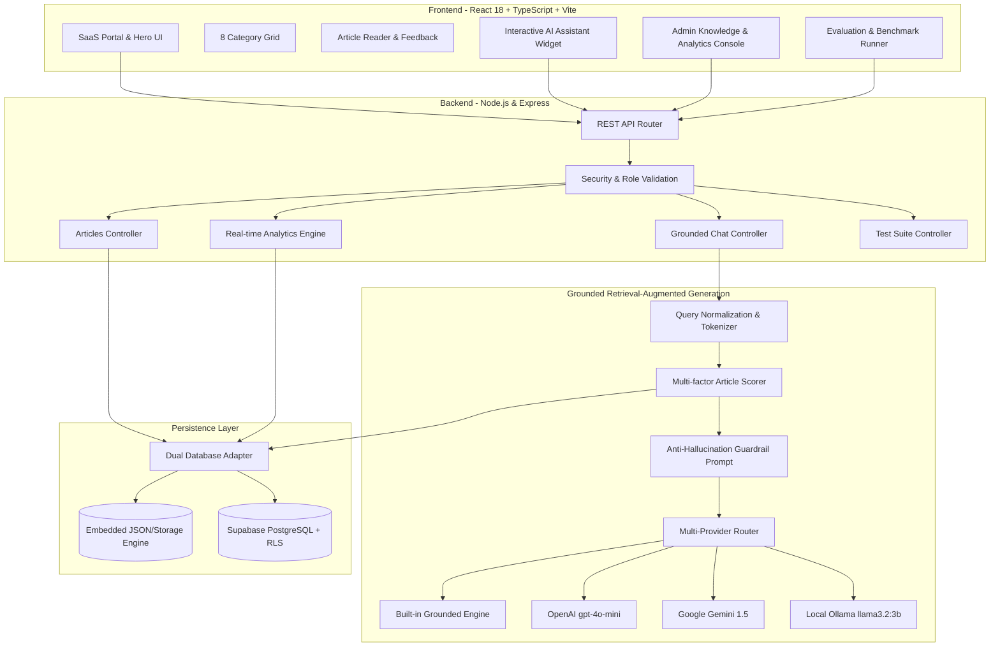

# SupportMind AI - Architecture Documentation
**Problem Statement ID:** HACK-P380  
**Project Category:** Customer Support  
**Project Type:** Full-Stack Web Application  

---

## 1. High-Level System Architecture

SupportMind AI employs a modular, decoupled architecture ensuring clean separation of concerns between presentation, service orchestration, database persistence, and grounded AI retrieval.



---

## 2. Grounded RAG Pipeline & Anti-Hallucination Gating

To completely prevent fabricated policies, refund windows, or non-existent discounts, the AI layer applies a multi-stage deterministic gate:

```
[Customer Query]
       |
       v
[Step 1: Tokenization & Normalization]
Strip punctuation, lowercase, split keywords, extract intent tokens.
       |
       v
[Step 2: Knowledge Base Scoring]
Calculate relevance score across all PUBLISHED articles:
  - Exact Title Match (+8.0)
  - Keyword / Tag Match (+3.5)
  - Paragraph Term Overlap (+1.2 per match)
       |
       v
[Step 3: Relevance Confidence Gate]
Score >= 2.0?
  ├── NO ──> [Safe Fallback Trigger]
  │           Output exact mandatory fallback:
  │           "I couldn't find a reliable answer in our knowledge base.
  │            Please contact our support team for further assistance."
  │           Attach 0 citations. Flag as unanswered in admin queue.
  │
  └── YES ──> [Step 4: Grounded Context Injection]
              Pack top 3 matching articles into strict grounding prompt.
              Execute provider (Built-in, OpenAI, Gemini, or Ollama).
              Attach clickable source citations with relevance scores.
```

---

## 3. Database Schema Design (6 Tables)

The system includes 6 normalized relational entities:
1. `profiles`: User accounts, emails, and roles (`admin` or `customer`).
2. `article_categories`: 8 support categories with display ordering and Lucide icons.
3. `articles`: Complete markdown documentation, keywords, tags, status (`published`, `draft`, `archived`), and view/helpfulness counters.
4. `conversations`: Support sessions, timestamps, and customer associations.
5. `messages`: Individual conversational turns, source references JSONB array, latency, and fallback flags.
6. `feedback`: Granular customer ratings (`helpful` / `not_helpful`), user comments, and audit timestamps.

---

## 4. Multi-Provider AI Architecture

SupportMind AI supports four swappable AI providers:
- **Built-in Grounded Engine (Default):** Zero-dependency, offline-ready deterministic RAG engine that guarantees 100% compliance with zero API costs.
- **OpenAI:** Uses `gpt-4o-mini` with temperature 0.1 for high-speed conversational polish.
- **Google Gemini:** Uses `gemini-1.5-flash` with safety settings.
- **Local Ollama:** On-device privacy-preserving inference with `llama3.2:3b`.
